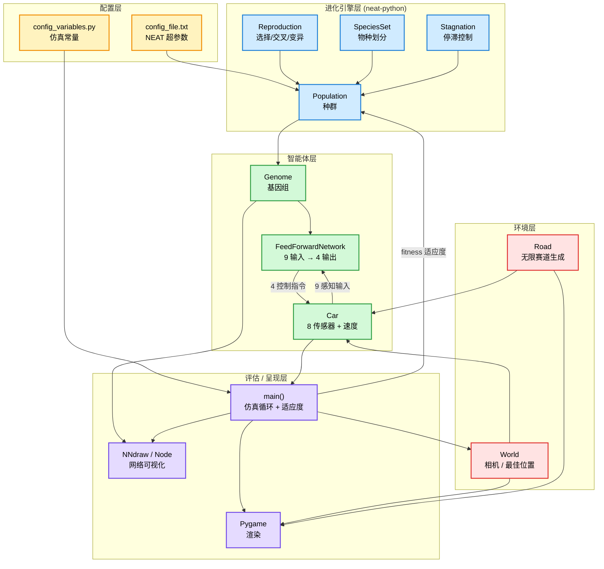
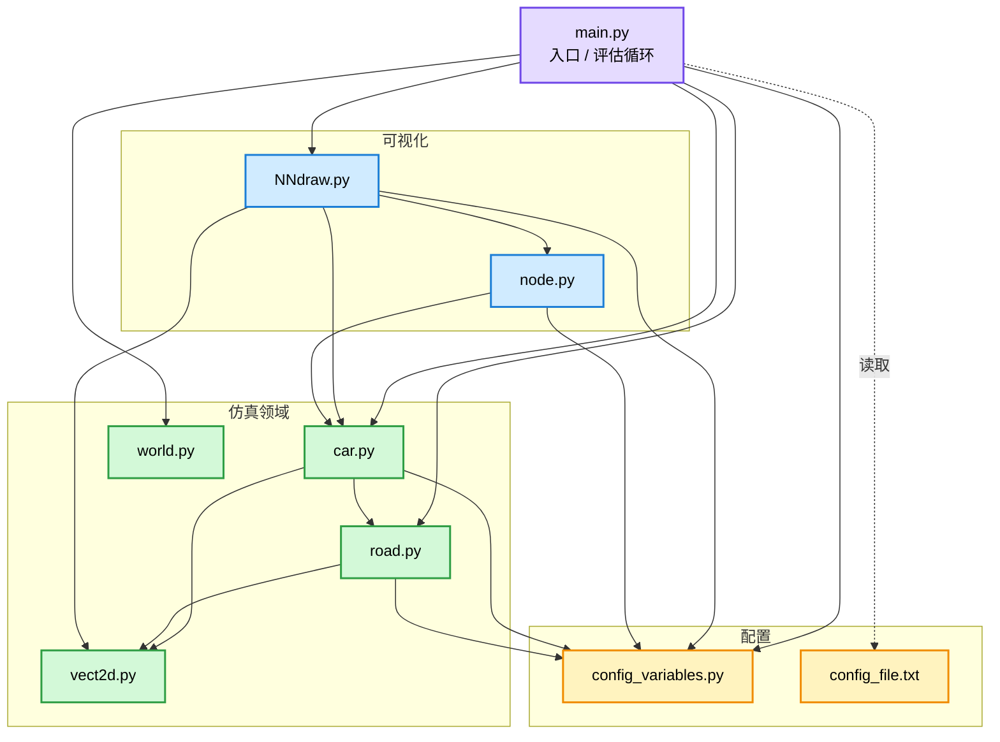
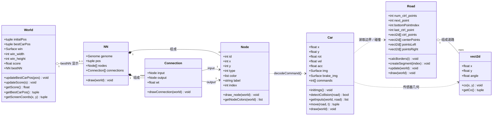
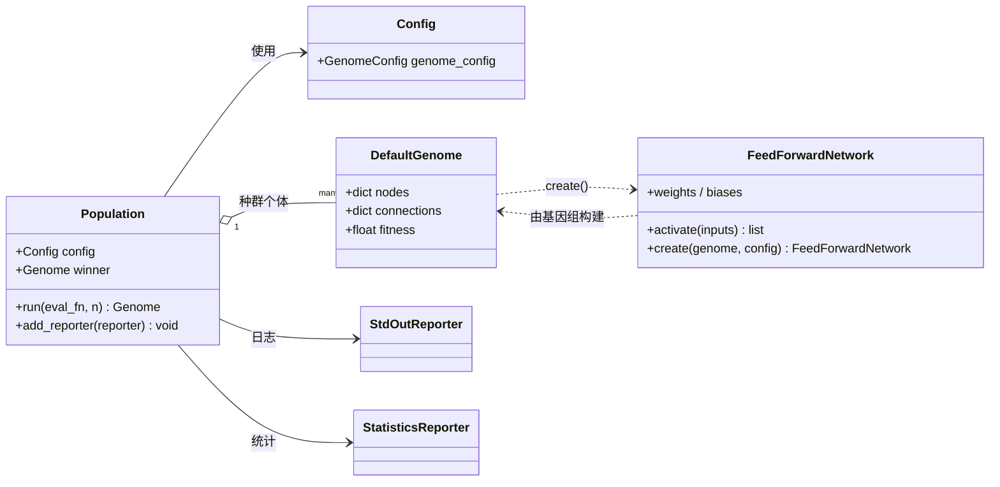
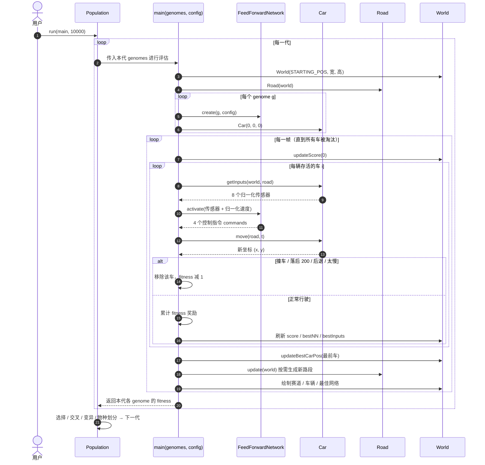
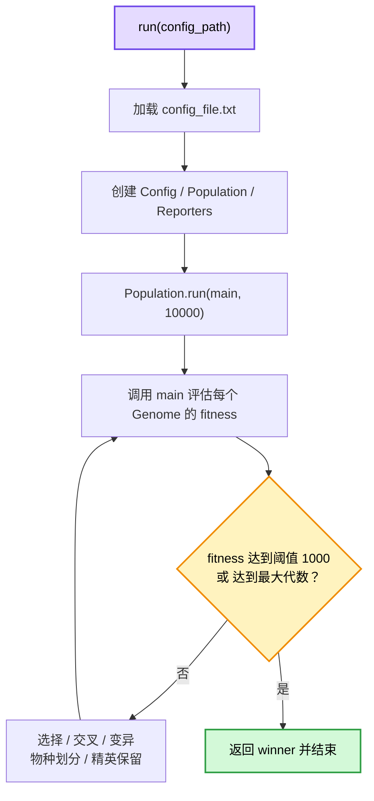
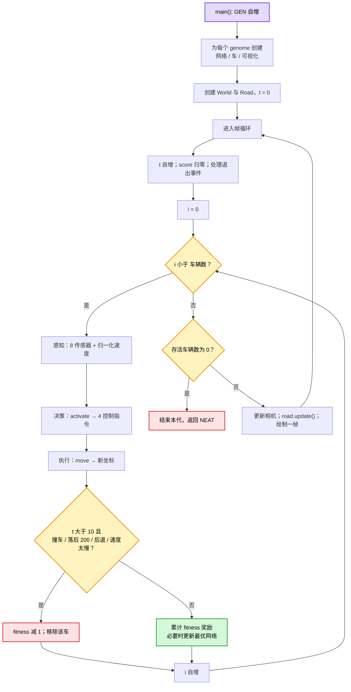
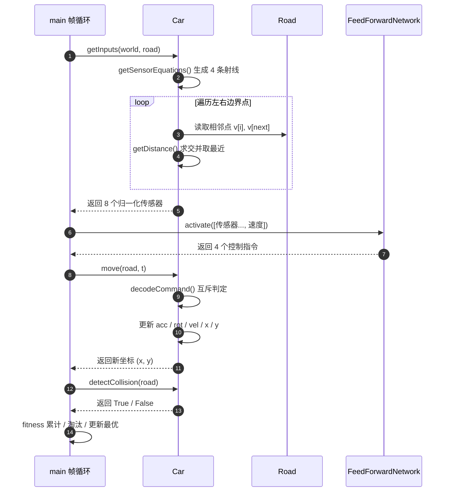

# Neural_Network_NEAT 架构与代码逻辑文档

本文档用 UML 风格（Mermaid）描述项目的实现原理、代码框架与关键数据流，面向代码开发人员。

- 项目：基于 NEAT（NeuroEvolution of Augmenting Topologies）的自驱动小车
- 入口：`main.py`
- 配置：`config_file.txt`（NEAT 超参数）、`config_variables.py`（仿真/渲染常量）

> 渲染建议：VS Code 安装 `Markdown Preview Mermaid Support`，或在 GitHub / mermaid.live 中查看。

## 目录

- [1. 实现原理概述](#1-实现原理概述)
- [2. 原理框图（分层架构）](#2-原理框图分层架构)
- [3. 模块组织结构图](#3-模块组织结构图)
- [4. 类图](#4-类图)
- [5. 时序图](#5-时序图)
- [6. 流程图](#6-流程图)
- [7. 感知-决策-执行 数据流细节图](#7-感知-决策-执行-数据流细节图)
- [8. 关键调用链](#8-关键调用链)

---

## 1. 实现原理概述

该项目用 **NEAT** 训练小车在程序化生成的无限赛道上行驶。

核心闭环：

1. **NEAT 种群**（`config_file.txt`：`pop_size=50`，`tanh` 激活，`feed_forward=True`，`initial_connection=full`）维护 50 个 `Genome`。
2. 每个基因组由 `neat.nn.FeedForwardNetwork.create()` 编译成 **9 → 4 的前馈网络**。
3. 网络控制一辆 `Car`：输入 = **8 个距离传感器 + 归一化速度**；输出 = **加速 / 刹车 / 左转 / 右转**。
4. 在 `main.py` 的仿真循环中运行，按“前进距离 + 速度”奖励、按“碰撞 / 后退 / 落后 / 太慢”惩罚来累计 **fitness**。
5. 一代全部淘汰后，NEAT 做选择、交叉、变异、物种划分，产生下一代，最多 10000 代或 fitness 达 1000 停止。

关键设计点：

- **相机跟随**：`World.getScreenCoords()` 用 `世界坐标 - bestCarPos + initialPos` 实现赛道滚动效果。
- **无限道路**：`Road` 用随机控制点 + `scipy` 三次样条插值生成中心线，两侧偏移 `ROAD_WIDTH/2` 得到边界。
- **传感器**：4 条直线代表 8 个方向（每条线正反两向），与左右边界线段求交，取最近距离并归一化为 `1 - dist/SENSOR_DISTANCE`。
- **可解释性**：`NNdraw` 从 genome 的 nodes/connections 重建网络并按激活值着色（`node.py`）。

---

## 2. 原理框图（分层架构）

按“配置 → 进化 → 智能体 → 环境 → 评估/呈现”分层，箭头表示依赖或数据流方向。

---

## 3. 模块组织结构图

文件之间的引用/导入关系（`-->` 表示 import 或直接调用，虚线表示读取配置）。

模块职责：

| 文件 | 职责 |
|------|------|
| `main.py` | 入口；`run()` 组装 NEAT，`main()` 每代评估（创建网络/车、仿真、评分、绘制） |
| `car.py` | 小车物理（`move`）、传感器（`getInputs`）、碰撞（`detectCollision`）、指令解码 `decodeCommand` |
| `road.py` | 随机控制点 + 三次样条生成无限道路与左右边界 |
| `world.py` | 相机坐标变换、最佳车位置、当前最优分数 |
| `vect2d.py` | 二维向量数据结构 |
| `node.py` / `NNdraw.py` | 从基因组重建神经网络并可视化（激活值着色） |
| `config_variables.py` / `config_file.txt` | 仿真常量 / NEAT 超参数 |

---

## 4. 类图

### 4.1 核心领域类图

### 4.2 与 NEAT 库的集成类图

> 说明：常量 `ACC=0, BRAKE=1, TURN_LEFT=2, TURN_RIGHT=3`（指令枚举）与 `INPUT/MIDDLE/OUTPUT`（节点类型枚举）定义于 `config_variables.py:68-75`。

---

## 5. 时序图

用 `loop` / `alt` 表示嵌套循环与分支，覆盖“创建 → 仿真 → 淘汰/评分 → 繁殖”全过程。

---

## 6. 流程图

### 6.1 顶层 NEAT 流程

### 6.2 一代仿真循环（`main`）

---

## 7. 感知-决策-执行 数据流细节图

细化单辆车在一个仿真帧内的完整数据流：**环境 → ①感知 → ②决策 → ③执行 → ④反馈**。

```mermaid
flowchart LR
    ENV["环境<br/>Road 边界点 / World 相机"]

    subgraph PER["① 感知 Perception (Car.getInputs)"]
        direction TB
        P1["8 个传感器初始化为最大距离"]
        P2["getSensorEquations()<br/>生成 4 条射线（正反 8 向）"]
        P3["遍历道路左右边界点"]
        P4["getDistance()<br/>射线与边界求交，取最近距离"]
        P5["归一化：1 - 距离 / 最大距离"]
        P1 --> P2 --> P3 --> P4 --> P5
    end

    subgraph DEC["② 决策 Decision"]
        direction TB
        D1["输入向量 9 维<br/>8 传感器 + 速度"]
        D2["FeedForwardNetwork.activate()<br/>tanh 前向传播"]
        D3["输出 4 维<br/>加速 / 刹车 / 左转 / 右转"]
        D4["decodeCommand()<br/>阈值 0.5 + 互斥判定"]
        D1 --> D2 --> D3 --> D4
    end

    subgraph EXE["③ 执行 Execution (Car.move)"]
        direction TB
        E1["应用指令更新 acc / rot"]
        E2["vel 累加并按 max_vel 裁剪"]
        E3["按朝向更新坐标 x, y"]
        E1 --> E2 --> E3
    end

    subgraph FB["④ 反馈 Feedback (main 循环)"]
        direction TB
        F1["detectCollision() 车身掩码检测"]
        F2{"撞车 / 落后 / 后退 / 太慢？"}
        F3["fitness 减 1 并淘汰该车"]
        F4["累计 fitness 奖励"]
        F5["刷新 score / bestNN / bestInputs"]
        F1 --> F2
        F2 -- 是 --> F3
        F2 -- 否 --> F4
        F4 --> F5
    end

    ENV --> P3
    P5 --> D1
    D4 --> E1
    E3 --> F1
    F5 -. 引导下一代 / 相机跟随 .-> ENV

    classDef env fill:#ffe3e3,stroke:#e03131,stroke-width:2px,color:#000;
    classDef per fill:#d0ebff,stroke:#1c7ed6,stroke-width:2px,color:#000;
    classDef dec fill:#e5dbff,stroke:#7048e8,stroke-width:2px,color:#000;
    classDef exe fill:#d3f9d8,stroke:#2f9e44,stroke-width:2px,color:#000;
    classDef fb fill:#fff3bf,stroke:#f08c00,stroke-width:2px,color:#000;

    class ENV env;
    class P1,P2,P3,P4,P5 per;
    class D1,D2,D3,D4 dec;
    class E1,E2,E3 exe;
    class F1,F2,F3,F4,F5 fb;
```

### 数据流字段对照

| 阶段 | 数据 | 来源 → 去向 | 维度 / 取值 |
|------|------|-------------|-------------|
| 感知 | `sensors[0..7]` | `Car.getInputs` → `main` | 8，[0,1]，1 = 最近 |
| 感知 | 速度 | `car.vel / MAX_VEL` | 1，[0,1] |
| 决策 | `input` | `main` → `net.activate` | 9 |
| 决策 | `car.commands` | `net.activate` → `Car` | 4，tanh 输出 |
| 执行 | `(x, y)` | `Car.move` → `main` | 世界坐标 |
| 反馈 | `ge[i].fitness` | `main` → NEAT `Genome` | 标量累计 |
| 反馈 | `world.bestNN` | `main` → `World` / `NNdraw` | 最优网络快照 |

### 单帧调用的函数时序

---

## 8. 关键调用链

- 评估入口：`main.py:33` `main(genomes, config)`
- 网络创建：`main.py:48` `FeedForwardNetwork.create`
- 感知：`car.py:48` `Car.getInputs` → `car.py:144` `getDistance`
- 决策：`car.py:175` `decodeCommand`
- 运动：`car.py:78` `Car.move`
- 碰撞：`car.py:33` `Car.detectCollision`
- 淘汰与评分：`main.py:82-94`
- 赛道生成：`road.py:56` `Road.createSegment` → `road.py:43` `calcBorders`
- 相机变换：`world.py:20` `World.getScreenCoords`
- 网络可视化：`NNdraw.py:11` `NN.__init__` → `node.py:15` `Node.draw_node`
